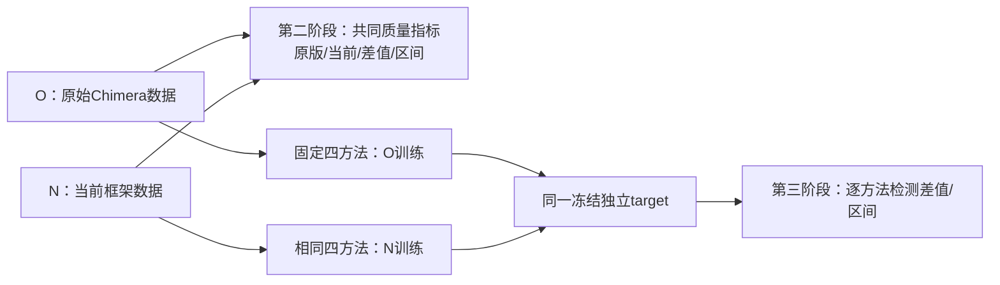

# Chimera评测：执行可信 → 原版/当前数据质量 → 同方法检测效用

更新：2026-10-13。分支：`research/dataset-evaluation-framework`。第一阶段已完成执行、明确规格业务与L0本地应用仿真验收；第二/第三阶段尚未执行，现有报告为任务与结果结构，不含实测分数。

**后两阶段主线：原始 Chimera 与当前框架的数据质量对比 → 使用相同检测方法验证检测效用差异。**

## 1. 比较对象

O为原始Chimera发布快照或固定原版commit的复现数据，N为当前框架新确认数据。原始来源尚待登记核验；当前legacy开关、第一阶段旧失败队列及round24原描述重放都不等于原版。已有原始快照不重复生成；复现偏离论文模型/配置时明确命名。

尽量匹配高层业务/角色/人数/时长/模型/样本和模态，各完整框架保留自身机制。公共快照条件不匹配时限定共同范围并说明混杂。规则/单轮DeepSeek/统计生成器和legacy开关仅为可选扩展，不占默认主预算。

## 2. 三阶段分别回答什么

| 阶段 | 问题 | 任务与报告 |
|---|---|---|
| 第一阶段：执行与记录可信 | 已知正常业务、异常和模拟攻击场景中，是否按规则执行并完整留证？ | [已完成总报告](reports/stage1/README.md)、[执行修复](reports/execution-repair/README.md) |
| 第二阶段：O/N数据质量 | 共同证据下，业务、结构、覆盖/多样性与语义有何改善、退化或不足？ | [Q1–Q7任务与成本](stage2-tasks-and-cost.md)、[质量报告结构](reports/stage2/README.md) |
| 第三阶段：同方法检测效用 | 分别用O/N训练相同检测器，在同一个独立target上效果有何变化？ | [D0–D5任务与成本](stage3-tasks-and-cost.md)、[检测报告结构](reports/stage3/README.md) |

第二阶段并列O值、N值、差值/95%CI、分母/coverage/能力。原版缺真实成果不填0，当前新增产物/血缘能力单列；没有外部R，O/N距离只说明差异，不证明更真实。

第三阶段固定原论文**RBF-SVM、Temporal CNN、GCN、DS-IID**。每方法同实现/架构/输入语义/训练量/调参预算、同验证协议和同target，分别训练两实例。轻量调试模型不替代四方法。优先合格外部holdout，否则同O_test/N_test共同池并报两域及预注册宏平均，不能只比各自测试集分数。

## 3. 公平比较与科学判定

原始来源、共同字段/标签、实际可观察时间/交接、生成版本、分割、四方法config、主target、指标/界限及预算在确认前冻结。计划/业务成功/交接只有共同规格和真实证据充分时横比；缺能力用不适用或未测，未知不填正常。

主质量比较为共同内容盲评分与严重语义缺陷率差值，共同oracle充分时加业务成功率；主检测比较为ΔAP、ΔRecall@固定审查预算。每项给分母、95%CI、最差组和失败；不合成总分，不以检测高分反推质量正确。实际独立run/员工群/episode/template成组统计，不能把大量事件当独立样本。

新增数据只生成一次，两阶段共享。所有模型生成/辅助评分仅用DeepSeek，确定性检查与检测训练本地执行。默认人工60校准＋180确认、每包3专家；模型升级不替代真人。预算不够或CI不足，保留未测/不确定，不能改通过线或只留成功。

## 4. 外部证据与可选扩展

CERT为外部合成参照/target，TWOS为人类竞赛来源，授权企业heldout才支持企业TSTR。获取、许可、标签和模态都要审核；未取得不能用内部共同池冒充外部有效。

外部增强R_only/R+duplicate/R+O/R+N、其他生成器和legacy/规划消融是可选扩展，独立manifest/样本/费用。当前前置缺口仍有业务时间、跨任务消费、原始来源与四方法实现适配；不因名称或方案存在宣称已运行。

## 5. 文件与成本入口

| 文件 | 用途 |
|---|---|
| [原版/当前主比较协议](comparison-validation.md) | 来源定义、共同字段、质量/检测矩阵、target、统计与可选边界 |
| [指标L0–L5](framework.md) | 公式、分母、证据与判定 |
| [实施顺序](implementation-plan.md) | 来源审核、先导、冻结、共享确认及报告 |
| [第二阶段任务/费用](stage2-tasks-and-cost.md) / [预算JSON](stage2-cost-estimate.json) | 默认移除四源生成/额外评审；API、人工与未知项分账 |
| [第三阶段任务/费用](stage3-tasks-and-cost.md) / [预算JSON](stage3-cost-estimate.json) | 同四方法训练工作量、CPU/GPU待测、API $0、共享生成不重算 |
| [人工与DeepSeek细则](judge-and-cost.md) | 四维量表、盲化、校准、模型资格与费用公式 |
| [来源/方法冻结模板](comparison-manifest.template.json) | O/N来源、共同验证、target与四检测器登记，待填hash不冒充冻结 |
| [论文调研](literature-review.md) | 25项链接、阅读级别与检索边界 |

复用原始快照时，当前短任务生成外推＋主语义评分可估算小计约$66.37–$101.89；原版重生成需先导实测，条件同单价量级约$132.20–$203.59，均非完整最高费用。独立评分36–72人小时；检测主流程API $0，四方法算力需实测。第一阶段已支出分开保存，任何共享生成不按阶段重复计费。

[完整检索](../../allinone.md)、[原始结果](evidence/search-results.json)、[来源核验](evidence/source-retrieval.json)、[方法证据](evidence/method-evidence.json)与[原四检测器核验](evidence/original-chimera-detectors.json)保存依据。旧版方案在Git历史，旧成本表另[归档](evidence/stage2-cost-estimate-before-original-comparison.json)。本次仅重构任务与报告，没有生成第二/第三阶段数据、付费模型评审、训练检测器或联系专家。

本次重构的[文档验证记录](evidence/comparison-protocol-verification.json)和[独立只读审查](evidence/comparison-protocol-review.md)仅验证方案一致性，不代表第二/第三阶段实验通过。
