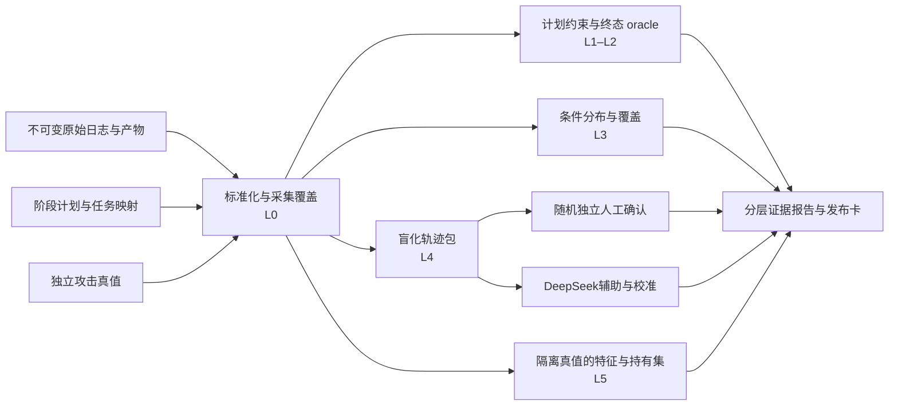

# ChimeraLog+ 数据集评测研究与实施方案

研究日期：2026-10-12。分支：`research/dataset-evaluation-framework`。起点：`feat/workflow-tool-execution` 的 `f218ca5`。本目录是论文调研与可实施规格；尚未实现评测程序，未执行付费模型调用或完整仿真，所有实验目标均不是实测结果。

评测对象是框架生成的**正常行为、攻击行为、跨工具产物、组织协作和检测数据集**。任务运行成功只是其中一项证据。沿用原图的 L0–L5，但补上采集可观测性、标签可信度、时序与群体覆盖、泄漏检查、独立评审以及统计不确定性。所有模型辅助评测只采用 DeepSeek。

建议按以下顺序阅读：

1. [论文调研](literature-review.md)：25 项参考文献、原始链接、证据阅读级别、能迁移的方法和限制。
2. [评测体系与指标规格](framework.md)：对原图的修订、各层公式、分母、数据源、判定规则与适用范围。
3. [详细实施与实验计划](implementation-plan.md)：采集补齐、黄金任务、对照与消融、分割、样本量、置信区间、实施里程碑及验收。
4. [DeepSeek 评审协议与成本计划](judge-and-cost.md)：标注量表、提示词、校准、升级条件、token 账本和费用例算。
5. [检索完整记录](../../allinone.md)：近期检索结果、筛选、主题总结和检索失败；[原始结果](evidence/search-results.json)保留摘要与元数据。
6. [来源核验记录](evidence/source-retrieval.json)、[方法证据摘录](evidence/method-evidence.json)：检索日期、状态、摘要/方法片段与原始内容哈希。

## 最终建议

采用“**全量可复算检查 + 抽样独立语义评审 + 无泄漏的下游对照**”。不合成一个总分；输出每项指标的值、分母、95% 区间、证据定位和 `PASS / FAIL / INCONCLUSIVE / NOT_MEASURED / NOT_APPLICABLE`。

- L0–L2 的硬约束来自数据契约与任务规格，不能靠模型猜测补齐。正常轨迹的越权与预定攻击轨迹的越权分别解释。
- L3 的分布距离、L4 的真实性和 L5 的效用必须由参考集、先导实验与预注册差异界限解释。原图里的 `KS ≤0.10`、`F1 ≥0.80` 等不是文献证明的通用质量门槛。
- 生成使用 DeepSeek、评审也使用 DeepSeek时存在共同偏差。人工盲评保留随机样本；不能只让专家看模型认为有问题的记录。
- 控制成本依靠共享特征提取、离线统计、证据打包、内容缓存、预定抽样和分阶段实验；不能删除失败轨迹、少数角色或难攻击来压低费用。

## 当前分支的实际限制

已经存在阶段规划流水线、任务级文件系统工作流、日志抽取与产物 manifest。新路径需要 `CHIMERA_WORKFLOW_EXECUTION=1`。当前任务 workspace 相互隔离；真实外发、共享访问、跨天记忆和系统捕获不能从 JSON 凭证推定。工具事件缺少统一时间/序号/业务成功字段；计划导出只留 `Time/Activity`；`test_run` 的调用成功不等于测试通过。实施计划首先补观测与 oracle，不把这些缺口写成已实现能力。

`dev` 的初步评测使用另一版 L1/L2 编号和 OrgCascade 原型，本分支没有直接合并。新规格以用户原图的编号为准，并用本分支的真实接口设计适配器。

## 证据流

